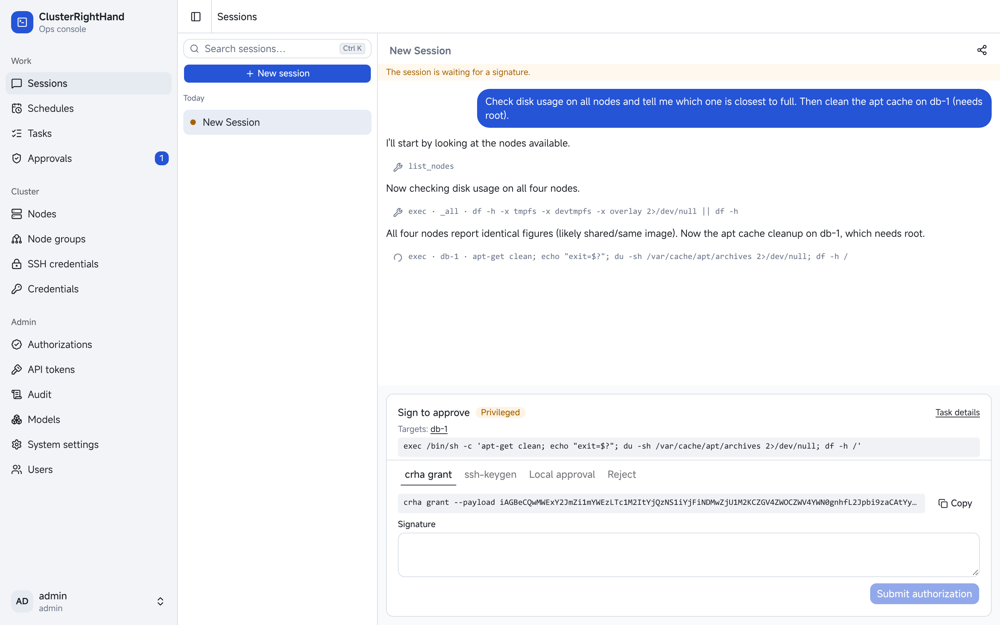
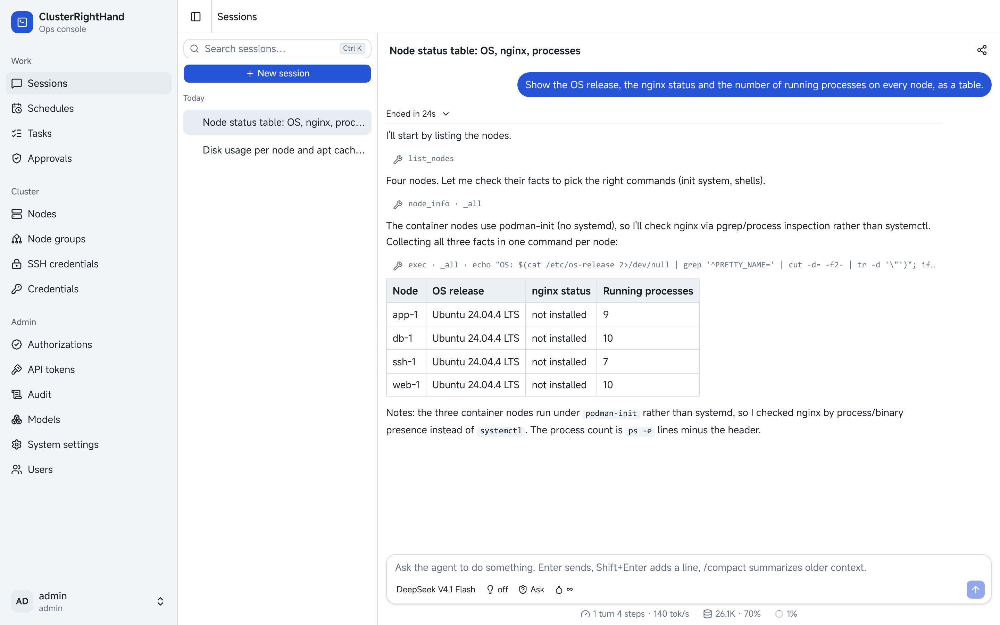
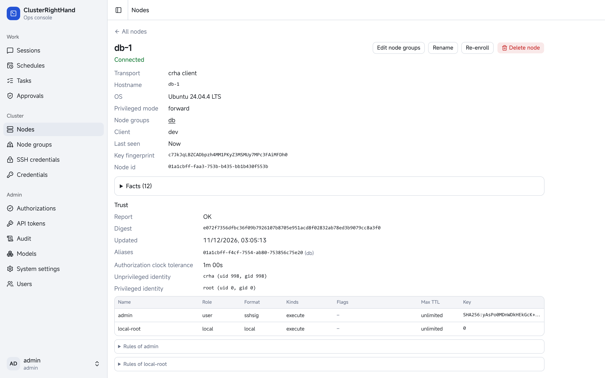

# ClusterRightHand

**English** | [简体中文](README.zh-CN.md)

ClusterRightHand (CRH) is a self-hosted multi-node agent platform with strict agent rules, node-trusted
privilege authorization and auditing.



## Highlights

- **Agent sessions across your nodes.** Run commands and file operations on one node, a node group or
  all of them at once, with subagents, per-session token quotas and scheduled sessions.
- **Privilege is decided on the node.** A node can require privileged tasks to carry an authorization
  it trusts: signed with a user's SSH key or Passkey and countersigned by the central server, or
  approved locally on the node. A node can refuse to let crhs elevate alone, so even a compromised
  central server cannot become root on it.
- **Two ways to reach a node.** Install the small `crha` agent, which dials out to crhs, or use plain
  SSH with nothing installed, through jump hosts if needed.
- **An MCP server too.** Plug it into your existing workflow: Claude Code, Codex and other MCP clients
  connect over MCP and get the same tools, under the same rules and approvals.
- **Simple to run.** One Node.js process serves the WebUI, the API, MCP, the agents and the scheduler,
  on SQLite or PostgreSQL. The WebUI is in English and Chinese.

| Sessions                                                                            | Node trust                                                                             |
| ----------------------------------------------------------------------------------- | -------------------------------------------------------------------------------------- |
|  |  |

## How it works

```text
 WebUI · MCP clients
        │
      crhs ── agent sessions, scheduler, rules, approvals, signing, audit
        │
   ┌────┴─────────────┐
 crha (WSS, dials out)  SSH
   │
 crha privileged mode (no network; runs only authorized tasks)
```

Every action, whether from a session, a schedule, the WebUI or an MCP client, becomes a task through one
API, so none of them can bypass the checks. See [Architecture](doc/design/architecture.md).

## Getting started

You need Linux, Node.js 24.7 or newer with pnpm, and Go to build `crha`.

1. [Install crhs](doc/guide/install.md), create the first administrator and configure a model provider.
2. [Enroll a node](doc/guide/install.md#enroll-a-node) with `crha`, or [add an SSH node](doc/guide/install.md#add-an-ssh-node).
3. Start a session in the WebUI, or [connect an MCP client](doc/guide/mcp.md).

Read the [concepts](doc/guide/concepts.md) first if you want the vocabulary: nodes, tasks, rules,
approvals and privilege.

## Documentation

**Guide**

| Page                                                                 | Covers                                              |
| -------------------------------------------------------------------- | --------------------------------------------------- |
| [Concepts](doc/guide/concepts.md)                                    | Nodes, tasks, sessions, rules, approvals, privilege |
| [Install](doc/guide/install.md)                                      | Setting up crhs, nodes and models                   |
| [Using the WebUI](doc/guide/webui.md)                                | A tour of the console                               |
| [MCP server](doc/guide/mcp.md)                                       | Connecting external coding agents                   |
| [Security](doc/guide/security.md)                                    | Trust, privilege modes, hardening                   |
| [Operations](doc/guide/operations.md)                                | Upgrades, backups, logs, troubleshooting            |
| [crhs configuration](doc/guide/reference/crhs-config.md)             | `crhs.toml` and system settings                     |
| [crha configuration](doc/guide/reference/crha-config.md)             | `crha.toml`                                         |
| [Privileged configuration](doc/guide/reference/privileged-config.md) | `privileged.toml`                                   |
| [Command line](doc/guide/reference/cli.md)                           | `crhs` and `crha` commands                          |

**Design**

| Document                                                   | Covers                                        |
| ---------------------------------------------------------- | --------------------------------------------- |
| [Architecture](doc/design/architecture.md)                 | Components, boundaries, limitations           |
| [Protocol](doc/design/protocol.md)                         | The crhs–crha protocol and transport security |
| [Execution plane](doc/design/execution.md)                 | Tasks, output, connections, SSH               |
| [Privilege and authorization](doc/design/privilege.md)     | Privilege modes, authorizations, node trust   |
| [Users, ownership and audit](doc/design/access-control.md) | Users, access, rules, approvals, audit        |
| [Agent runtime](doc/design/agent-runtime.md)               | Sessions, tools, subagents, quotas            |
| [Scheduled tasks](doc/design/scheduling.md)                | Schedules                                     |
| [Data model](doc/design/data-model.md)                     | Storage and retention                         |
| [WebUI](doc/design/webui.md)                               | Frontend design                               |
| [Testing](doc/design/testing/README.md)                    | Test layers and how to run them               |

## Repository layout

| Path        | Contents                                                       |
| ----------- | -------------------------------------------------------------- |
| `server/`   | crhs (TypeScript, Node.js)                                     |
| `web/`      | The WebUI (React)                                              |
| `client/`   | crha (Go)                                                      |
| `packages/` | Shared TypeScript packages: API types, the CRH protocol, Noise |
| `doc/`      | The guide and the design documents                             |

## License

MIT; see [LICENSE](LICENSE).
