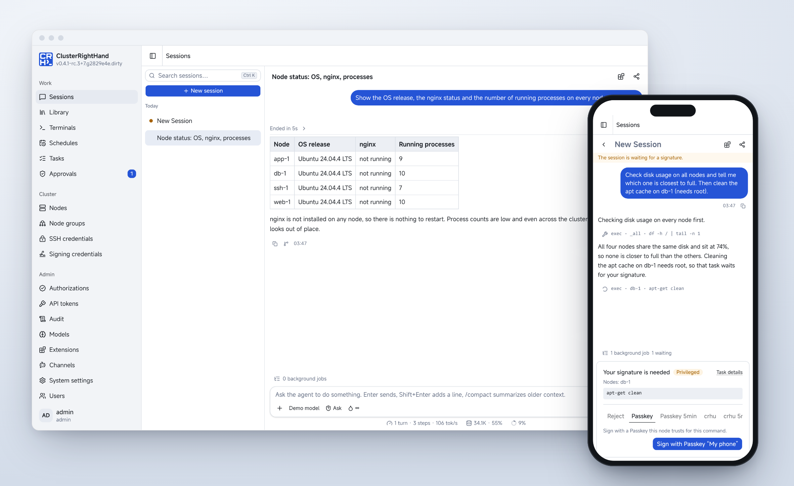
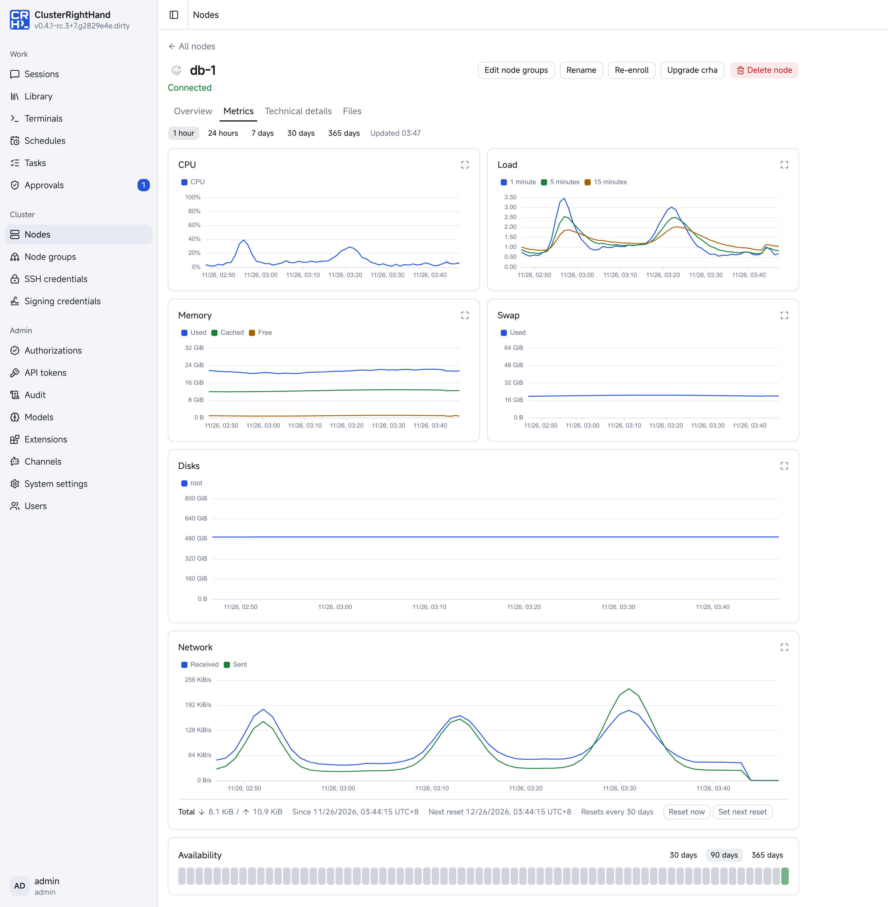

# ClusterRightHand

**English** | [简体中文](README.zh-CN.md)

ClusterRightHand (CRH) is a self-hosted multi-node agent platform with strict agent rules, node-trusted
privilege authorization and auditing.



## Highlights

**Core**

- **A native multi-node agent runtime.** Nodes and node groups are direct arguments of the agent's tools:
  one call runs a command or a file operation on a whole group and returns the result per node.
- **Rules, approvals and audit.** Every task an agent starts is first allowed, denied or held for approval
  by the rules, and every task is recorded in the audit log.
- **Privilege is decided on the node.** A node can require a privileged task to carry a user's SSH key or
  Passkey signature, or a local approval; when the node is configured well, a compromised central server
  cannot become root on it alone.
- **Two ways to reach a node.** Install the `crha` client, which dials out, or connect over SSH with no
  CRH component on the node.
- **Manages CRH itself and serves as an MCP server.** The agent can call the crhs API by its documentation;
  Claude Code, Codex and other MCP clients can use the same cluster tools under the same rules.

**Additional features**

- **Interactive terminals.** Open a terminal on a crha node in the WebUI; people and agents can share it.
- **Host metrics.** crhs collects CPU, memory, disk and network metrics from the nodes, with no separate
  monitoring agent.
- **Chat channels.** Use sessions and answer approvals from a chat app through Telegram or Satori.
- **Scheduled tasks.** Start a session with a preset prompt on a cron schedule.
- **Simple to deploy.** One Node.js process with SQLite or PostgreSQL.

| Node metrics                                                                                               | Node trust                                                                                        |
| ---------------------------------------------------------------------------------------------------------- | ------------------------------------------------------------------------------------------------- |
|  |  |

## How it works

```text
 WebUI · MCP clients
        │
      crhs ── agent sessions, scheduler, rules, approvals, signing, audit
        │
   ┌────┴─────────────┐
 crha (WSS, dials out)  SSH
   │
 crha privileged mode (no network; runs only authorized tasks)
```

Every action, whether from a session, a schedule, the WebUI or an MCP client, becomes a task through one
API, so none of them can bypass the checks. See [Architecture](doc/design/architecture.md).

## Getting started

You need a glibc Linux host (amd64 or arm64) for crhs and for each node, and a reverse proxy with TLS in
front of crhs.

1. [Install crhs](doc/guide/install.md) from the tar or the container image and initialize it
   (`sudo crhs init`, or the first container start), then configure a model provider.
2. [Enroll a node](doc/guide/install.md#enroll-a-node) with `sudo crha enroll`, or
   [add an SSH node](doc/guide/install.md#add-an-ssh-node).
3. Start a session in the WebUI, or [connect an MCP client](doc/guide/mcp.md).

Read the [concepts](doc/guide/concepts.md) first if you want the vocabulary: nodes, tasks, rules,
approvals and privilege.

## Documentation

**Guide**

| Page                                                                 | Covers                                              |
| -------------------------------------------------------------------- | --------------------------------------------------- |
| [Concepts](doc/guide/concepts.md)                                    | Nodes, tasks, sessions, rules, approvals, privilege |
| [Install](doc/guide/install.md)                                      | Setting up crhs, nodes and models                   |
| [Using the WebUI](doc/guide/webui.md)                                | A tour of the console                               |
| [MCP server](doc/guide/mcp.md)                                       | Connecting external coding agents                   |
| [Security](doc/guide/security.md)                                    | Trust, privilege modes, hardening                   |
| [Operations](doc/guide/operations.md)                                | Upgrades, backups, logs, troubleshooting            |
| [crhs configuration](doc/guide/reference/crhs-config.md)             | `crhs.toml` and system settings                     |
| [crha configuration](doc/guide/reference/crha-config.md)             | `crha.toml`                                         |
| [Privileged configuration](doc/guide/reference/privileged-config.md) | `privileged.toml`                                   |
| [Command line](doc/guide/reference/cli.md)                           | `crhs`, `crha` and `crhu` commands                  |

**Design**

| Document                                                   | Covers                                         |
| ---------------------------------------------------------- | ---------------------------------------------- |
| [Architecture](doc/design/architecture.md)                 | Components, boundaries, limitations            |
| [Compatibility](doc/design/compatibility.md)               | What a release keeps for earlier deployments   |
| [Protocol](doc/design/protocol.md)                         | The crhs–crha protocol and transport security  |
| [Execution plane](doc/design/execution.md)                 | Tasks, output, connections, SSH                |
| [Privilege and authorization](doc/design/privilege.md)     | Privilege modes, authorizations, node trust    |
| [Users, ownership and audit](doc/design/access-control.md) | Users, access, rules, approvals, audit         |
| [Agent runtime](doc/design/agent-runtime.md)               | Sessions, tools, subagents, quotas             |
| [Jobs](doc/design/jobs.md)                                 | Background work, job tools, completion notices |
| [Terminals](doc/design/pty.md)                             | Interactive terminals on crha nodes            |
| [Metrics](doc/design/metrics.md)                           | Host metrics, their storage and charts         |
| [Libraries and file transfer](doc/design/library.md)       | Libraries, file plane, attachments             |
| [Scheduled tasks](doc/design/scheduling.md)                | Schedules                                      |
| [Data model](doc/design/data-model.md)                     | Storage and retention                          |
| [WebUI](doc/design/webui.md)                               | Frontend design                                |
| [Distribution and setup](doc/design/distribution.md)       | Packages, `crhs init`, `crha enroll`           |
| [Testing](doc/design/testing/README.md)                    | Test layers and how to run them                |

## Repository layout

| Path        | Contents                                                       |
| ----------- | -------------------------------------------------------------- |
| `server/`   | crhs (TypeScript, Node.js)                                     |
| `web/`      | The WebUI (React)                                              |
| `client/`   | crha and crhu (Go)                                             |
| `packages/` | Shared TypeScript packages: API types, the CRH protocol, Noise |
| `doc/`      | The guide and the design documents                             |

## License

MIT; see [LICENSE](LICENSE).
