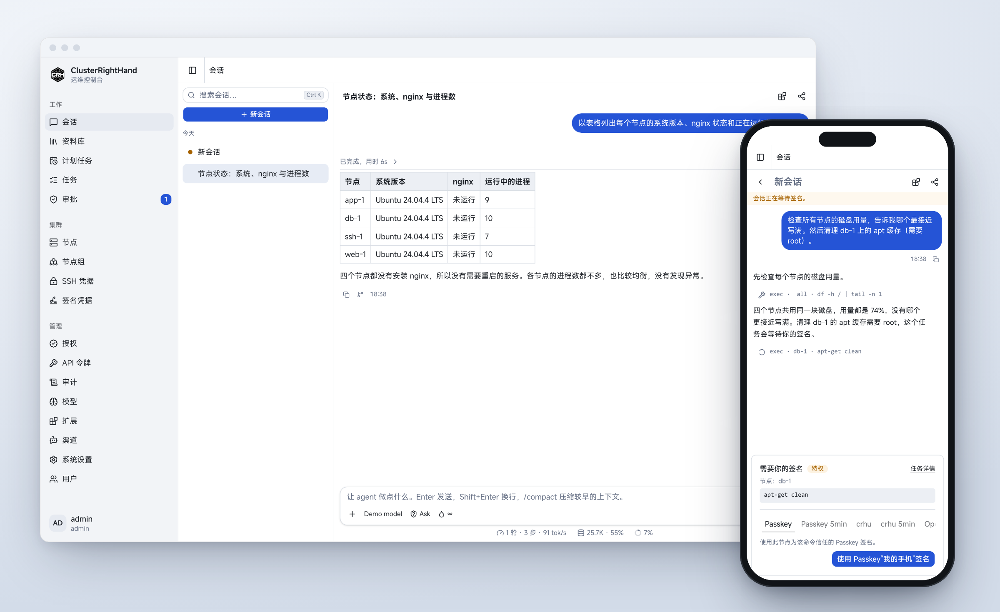
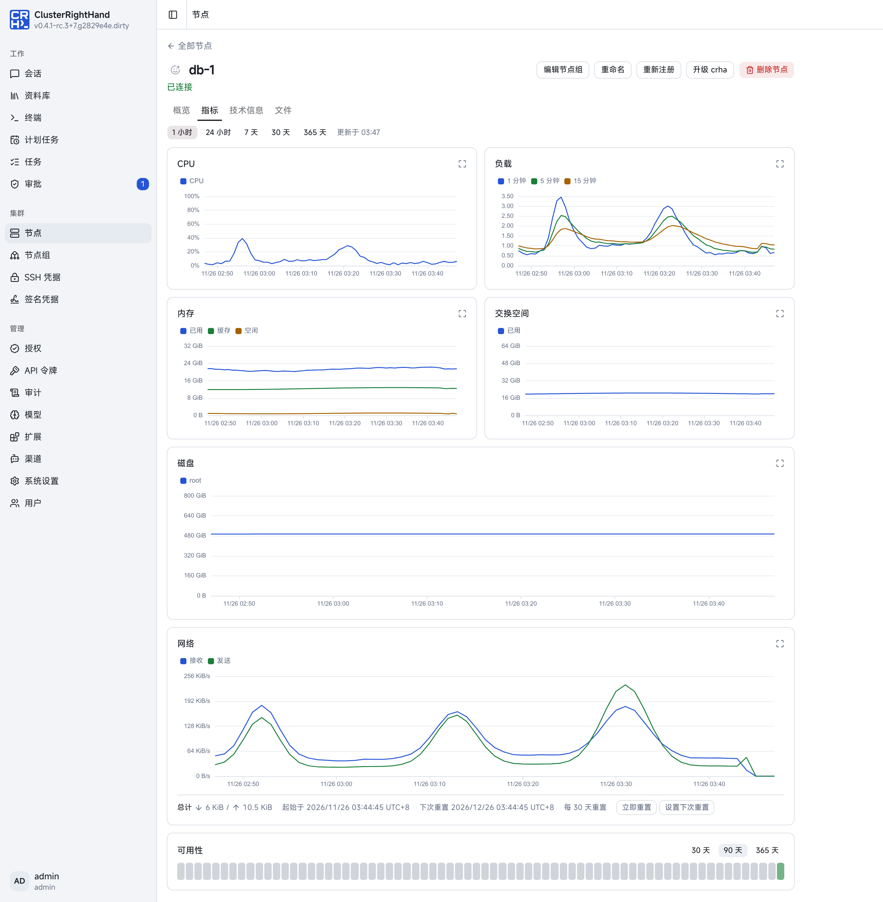
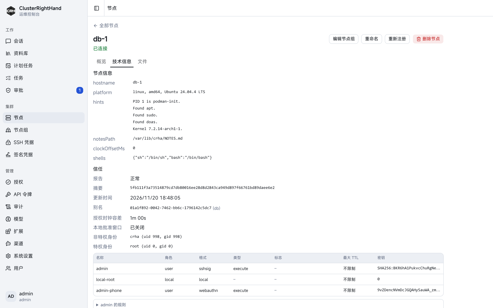

# ClusterRightHand

[English](README.md) | **简体中文**

ClusterRightHand（CRH）是一个自托管的多节点 Agent 平台，带有严格 Agent 规则，特权信任授权和审计功能。



## 特性

**核心功能**

- **原生多节点的 Agent Runtime。** 节点和节点组是 Agent 工具的直接参数，一次调用即可在整组节点上执行命令或操作文件，并按节点返回结果。
- **规则、审批与审计。** Agent 发起的每个任务先经规则判定为放行、拒绝或待审批，所有任务均记入审计。
- **特权由节点决定。** 节点可要求特权任务持有用户的 SSH 密钥或 Passkey 签名，或经本地批准；良好的配置下，中心服务器被攻破也无法单独取得 root。
- **两种接入方式。** 安装主动连接的 `crha` 客户端，或直接通过 SSH 接入，节点上无需任何 CRH 组件。
- **管理 CRH 自身，兼作 MCP 服务器。** Agent 可依据文档调用 crhs 的 API；Claude Code、Codex 等 MCP 客户端可接入使用同一套集群工具，并受相同约束。

**辅助功能**

- **交互式终端。** 在 WebUI 中打开 crha 节点上的终端，人与 Agent 可共用同一终端。
- **主机指标。** crhs 直接从节点采集 CPU、内存、磁盘和网络等指标，无需另装监控代理。
- **聊天渠道。** 通过 Telegram 或 Satori 在聊天应用中使用会话、处理审批。
- **计划任务。** 按 cron 表达式定时启动会话，执行预设的提示词。
- **部署简便。** 单个 Node.js 进程，数据存储于 SQLite 或 PostgreSQL。

| 节点指标                                                                                  | 节点信任                                                                              |
| ----------------------------------------------------------------------------------------- | ------------------------------------------------------------------------------------- |
|  |  |

## 工作方式

```text
 WebUI · MCP 客户端
        │
      crhs ── Agent 会话、调度器、规则、审批、签名、审计
        │
   ┌────┴─────────────┐
 crha（WSS，主动连接）  SSH
   │
 crha 特权模式（无网络，只执行已授权的任务）
```

无论来自会话、计划任务、WebUI 还是 MCP 客户端，每个操作都通过同一个 API 变成任务，任何入口都绕不过这些检查。详见
[Architecture](doc/design/architecture.md)。

## 快速开始

crhs 和每个节点都需要 glibc Linux（amd64 或 arm64），crhs 前面还需要一个带 TLS 的反向代理。

1. [安装 crhs](doc/guide/install.md)（二进制包或容器镜像），初始化（运行 `sudo crhs init`，容器首次启动时自动完成），并配置模型提供方。
2. 用 `sudo crha enroll` [注册节点](doc/guide/install.md#enroll-a-node)，或[添加 SSH 节点](doc/guide/install.md#add-an-ssh-node)。
3. 在 WebUI 里新建会话，或[接入 MCP 客户端](doc/guide/mcp.md)。

想先了解节点、任务、规则、审批和特权这些概念，可以读 [Concepts](doc/guide/concepts.md)。

## 文档

**使用指南**

| 页面                                                                 | 内容                               |
| -------------------------------------------------------------------- | ---------------------------------- |
| [Concepts](doc/guide/concepts.md)                                    | 节点、任务、会话、规则、审批、特权 |
| [Install](doc/guide/install.md)                                      | 安装 crhs、节点和模型              |
| [Using the WebUI](doc/guide/webui.md)                                | 控制台导览                         |
| [MCP server](doc/guide/mcp.md)                                       | 接入外部编程 Agent                 |
| [Security](doc/guide/security.md)                                    | 信任、特权模式、加固               |
| [Operations](doc/guide/operations.md)                                | 升级、备份、日志、故障排查         |
| [crhs configuration](doc/guide/reference/crhs-config.md)             | `crhs.toml` 和系统设置             |
| [crha configuration](doc/guide/reference/crha-config.md)             | `crha.toml`                        |
| [Privileged configuration](doc/guide/reference/privileged-config.md) | `privileged.toml`                  |
| [Command line](doc/guide/reference/cli.md)                           | `crhs` 和 `crha` 命令              |

**设计文档**

| 文档                                                       | 内容                                 |
| ---------------------------------------------------------- | ------------------------------------ |
| [Architecture](doc/design/architecture.md)                 | 组件、边界、限制                     |
| [Compatibility](doc/design/compatibility.md)               | 发布版本之间的兼容承诺               |
| [Protocol](doc/design/protocol.md)                         | crhs 与 crha 的协议和传输安全        |
| [Execution plane](doc/design/execution.md)                 | 任务、输出、连接、SSH                |
| [Privilege and authorization](doc/design/privilege.md)     | 特权模式、授权、节点信任             |
| [Users, ownership and audit](doc/design/access-control.md) | 用户、访问、规则、审批、审计         |
| [Agent runtime](doc/design/agent-runtime.md)               | 会话、工具、子 Agent、配额           |
| [Jobs](doc/design/jobs.md)                                 | 后台工作、job 工具、完成通知         |
| [Terminals](doc/design/pty.md)                             | crha 节点上的交互式终端              |
| [Metrics](doc/design/metrics.md)                           | 主机指标、存储和图表                 |
| [Scheduled tasks](doc/design/scheduling.md)                | 计划任务                             |
| [Data model](doc/design/data-model.md)                     | 存储和数据保留                       |
| [WebUI](doc/design/webui.md)                               | 前端设计                             |
| [Distribution and setup](doc/design/distribution.md)       | 打包分发、`crhs init`、`crha enroll` |
| [Testing](doc/design/testing/README.md)                    | 测试分层和运行方法                   |

## 仓库结构

| 路径        | 内容                                            |
| ----------- | ----------------------------------------------- |
| `server/`   | crhs（TypeScript，Node.js）                     |
| `web/`      | WebUI（React）                                  |
| `client/`   | crha（Go）                                      |
| `packages/` | 共享的 TypeScript 包：API 类型、CRH 协议、Noise |
| `doc/`      | 使用指南和设计文档                              |

## 许可证

MIT，见 [LICENSE](LICENSE)。
