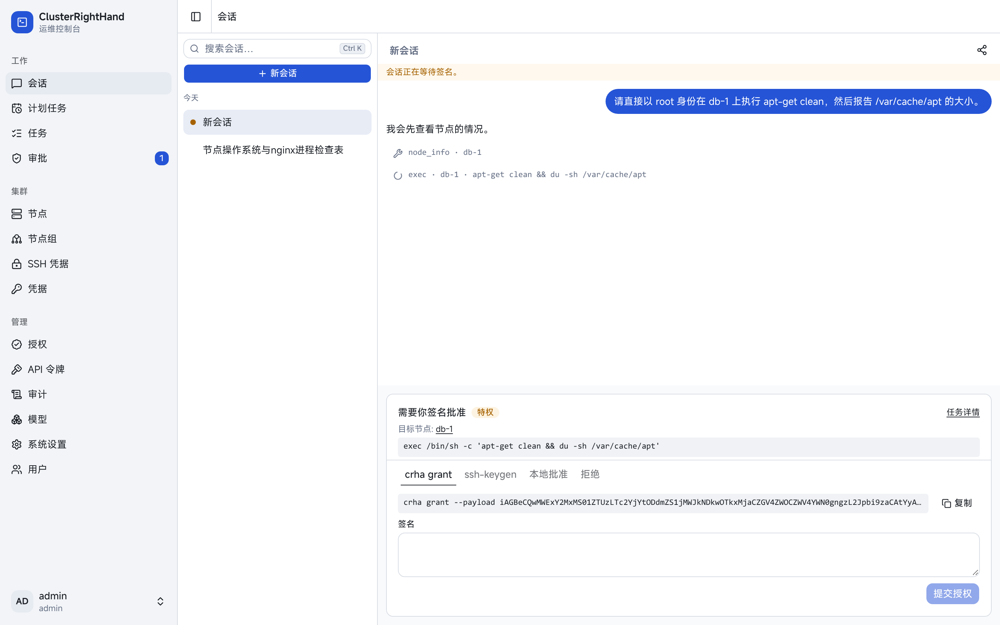
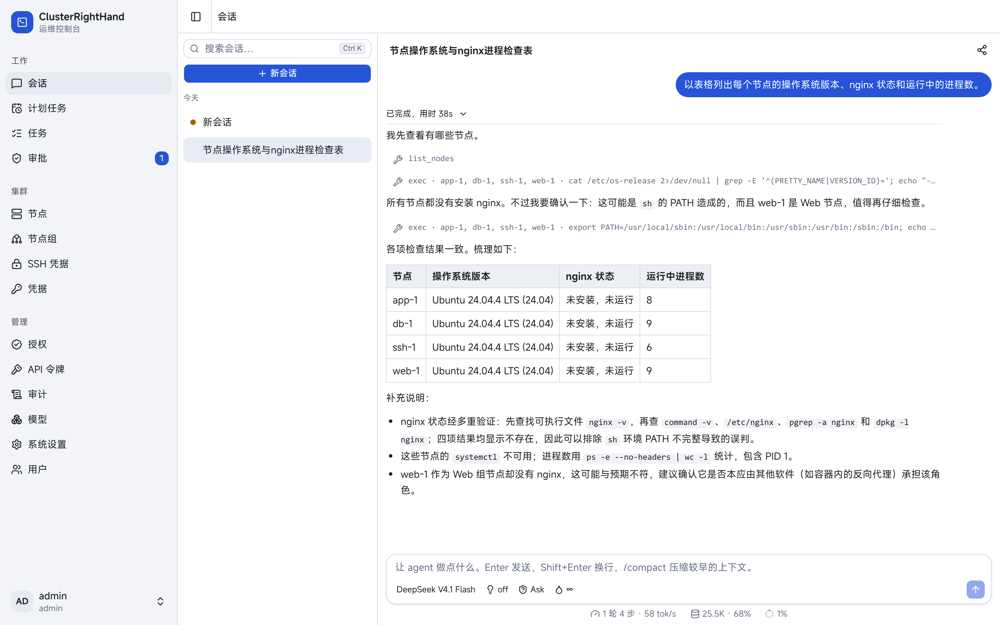
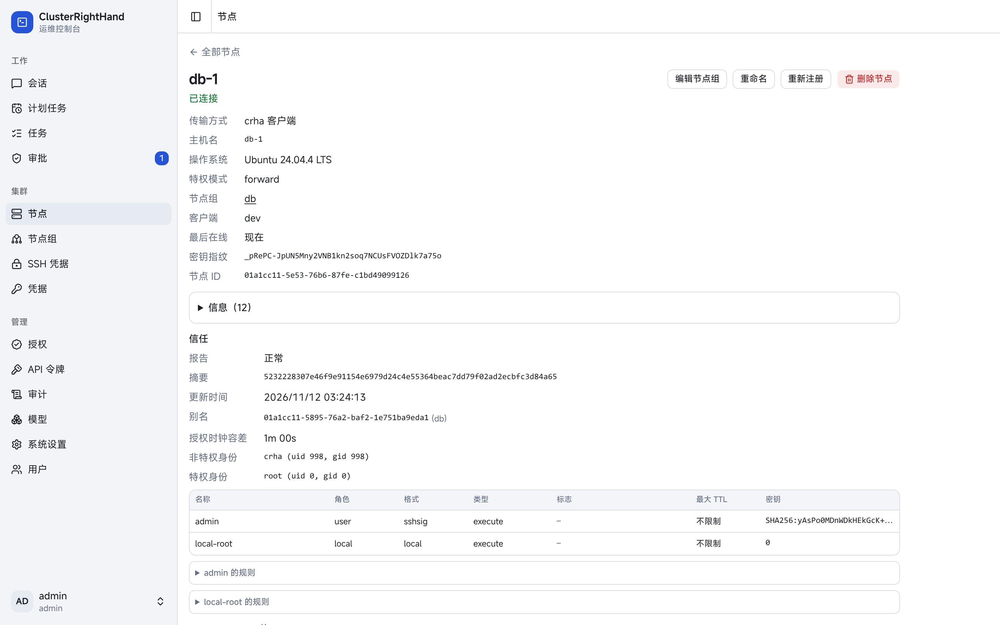

# ClusterRightHand

[English](README.md) | **简体中文**

ClusterRightHand（CRH）是一个自托管的多节点 agent 平台，带有严格 agent 规则，特权信任授权和审计功能。



## 特性

- **跨节点的 agent 会话。** 在单个节点、节点组或全部节点上执行命令和文件操作，支持子 agent、按会话的 token
  配额和计划任务。
- **特权由节点决定。** 特权任务可以配置为要求节点信任授权：由用户的 SSH 密钥或 Passkey
  签名并有中心服务器联署，或在节点上本地批准。节点可以配置为不允许 crhs 单独提权，即使中心被攻破，也拿不到节点的 root。
- **两种接入方式。** 安装小巧的 `crha` 客户端，由它主动连接 crhs；或者直接走 SSH，节点上什么都不用装，必要时可经过跳板机。
- **同时是 MCP 服务器。** 直接接入现有工作流，Claude Code、Codex 等 MCP 客户端可以接入 MCP 使用同一套工具，受同样的规则和审批约束。
- **部署简单。** 一个 Node.js 进程提供 WebUI、API、MCP、agent 和调度器，数据存 SQLite 或 PostgreSQL。WebUI 支持中文和英文。

| 会话                                                            | 节点信任                                                                |
| --------------------------------------------------------------- | ----------------------------------------------------------------------- |
|  |  |

## 工作方式

```text
 WebUI · MCP 客户端
        │
      crhs ── agent 会话、调度器、规则、审批、签名、审计
        │
   ┌────┴─────────────┐
 crha（WSS，主动连接）  SSH
   │
 crha 特权模式（无网络，只执行已授权的任务）
```

无论来自会话、计划任务、WebUI 还是 MCP 客户端，每个操作都通过同一个 API 变成任务，任何入口都绕不过这些检查。详见
[Architecture](doc/design/architecture.md)。

## 快速开始

需要 Linux、Node.js 24.7 及以上和 pnpm，构建 `crha` 还需要 Go。

1. [安装 crhs](doc/guide/install.md)，创建第一个管理员，配置模型提供方。
2. 用 `crha` [注册节点](doc/guide/install.md#enroll-a-node)，或[添加 SSH 节点](doc/guide/install.md#add-an-ssh-node)。
3. 在 WebUI 里新建会话，或[接入 MCP 客户端](doc/guide/mcp.md)。

想先了解节点、任务、规则、审批和特权这些概念，可以读 [Concepts](doc/guide/concepts.md)。

## 文档

**使用指南**

| 页面                                                                 | 内容                               |
| -------------------------------------------------------------------- | ---------------------------------- |
| [Concepts](doc/guide/concepts.md)                                    | 节点、任务、会话、规则、审批、特权 |
| [Install](doc/guide/install.md)                                      | 安装 crhs、节点和模型              |
| [Using the WebUI](doc/guide/webui.md)                                | 控制台导览                         |
| [MCP server](doc/guide/mcp.md)                                       | 接入外部编程 agent                 |
| [Security](doc/guide/security.md)                                    | 信任、特权模式、加固               |
| [Operations](doc/guide/operations.md)                                | 升级、备份、日志、故障排查         |
| [crhs configuration](doc/guide/reference/crhs-config.md)             | `crhs.toml` 和系统设置             |
| [crha configuration](doc/guide/reference/crha-config.md)             | `crha.toml`                        |
| [Privileged configuration](doc/guide/reference/privileged-config.md) | `privileged.toml`                  |
| [Command line](doc/guide/reference/cli.md)                           | `crhs` 和 `crha` 命令              |

**设计文档**

| 文档                                                       | 内容                          |
| ---------------------------------------------------------- | ----------------------------- |
| [Architecture](doc/design/architecture.md)                 | 组件、边界、限制              |
| [Protocol](doc/design/protocol.md)                         | crhs 与 crha 的协议和传输安全 |
| [Execution plane](doc/design/execution.md)                 | 任务、输出、连接、SSH         |
| [Privilege and authorization](doc/design/privilege.md)     | 特权模式、授权、节点信任      |
| [Users, ownership and audit](doc/design/access-control.md) | 用户、访问、规则、审批、审计  |
| [Agent runtime](doc/design/agent-runtime.md)               | 会话、工具、子 agent、配额    |
| [Scheduled tasks](doc/design/scheduling.md)                | 计划任务                      |
| [Data model](doc/design/data-model.md)                     | 存储和数据保留                |
| [WebUI](doc/design/webui.md)                               | 前端设计                      |
| [Testing](doc/design/testing/README.md)                    | 测试分层和运行方法            |

## 仓库结构

| 路径        | 内容                                            |
| ----------- | ----------------------------------------------- |
| `server/`   | crhs（TypeScript，Node.js）                     |
| `web/`      | WebUI（React）                                  |
| `client/`   | crha（Go）                                      |
| `packages/` | 共享的 TypeScript 包：API 类型、CRH 协议、Noise |
| `doc/`      | 使用指南和设计文档                              |

## 许可证

MIT，见 [LICENSE](LICENSE)。
